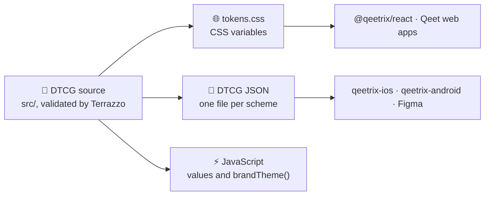

<div align="center">

# 🎨 Qeetrix Tokens

**The design tokens of Qeetrix, the Qeet Group design system: one source, in the DTCG standard, for every Qeet product
on the web, iOS and Android.**

[](https://www.npmjs.com/package/@qeetrix/tokens)
[](https://github.com/qeetgroup/qeetrix-tokens/actions/workflows/ci.yml)
[](https://www.designtokens.org/)
[](docs/quality.md)
[](package.json)
[](LICENSE)

[🌐 ui.qeet.in](https://ui.qeet.in/foundations) · [🚀 Quick start](#-quick-start) · [🎨 Token reference](docs/token-reference.md) · [🏢 Tenant brand](docs/brand-theme.md) · [📝 Changelog](CHANGELOG.md)

</div>

## 📦 What's inside

| | |
|:--|:--|
| 🎯 **216 tokens** | Colour, typography, space, shape, elevation, motion and density, as semantic roles such as `--qx-color-bg-danger-bold` |
| 🌗 **Themes without JavaScript** | Light and dark, and three densities, set by data attributes on any element |
| ♿ **Accessible by construction** | Every designed colour pairing meets WCAG 2.2 AA in both schemes, and a test checks each one |
| 🏢 **Safe white-labelling** | `brandTheme()` turns a customer's colour into the brand tokens, with AA contrast for any input |
| 📈 **Charts for everyone** | A categorical palette that stays distinct under deuteranopia, protanopia and tritanopia |
| 🔤 **Fonts included** | Qeet Sans and Fira Code, split by script, so a page downloads only what it shows |
| 🪶 **Small and trusted** | No runtime dependencies, ES modules, fully typed, published with npm provenance |

## 🔗 How it fits



## 🚀 Quick start

```sh
bun add @qeetrix/tokens
```

Import the stylesheet once, at the root of your app (the full path works in every bundler, and from JavaScript too),
then style with the semantic tokens:

```css
@import "@qeetrix/tokens/tokens.css";

.card {
  background: var(--qx-color-surface-raised);
  color: var(--qx-color-text-default);
  border: var(--qx-border-width-default) solid var(--qx-color-border-default);
  border-radius: var(--qx-radius-surface);
  padding: var(--qx-space-inset-lg);
  font: var(--qx-typography-body-md);
}
```

Choose the colour scheme and density on `<html>` or any element; a dark sidebar or a compact table needs only its own
attribute:

```html
<html data-qx-color-scheme="dark" data-qx-density="compact">
```

With Tailwind CSS v4, import `@qeetrix/react/tailwind.css` after Tailwind for utilities named after these tokens
(`bg-surface-raised`, `rounded-control`, `p-inset-md`).

## 🧭 What's in the package

| Import | For | Contains |
|:--|:--|:--|
| `@qeetrix/tokens/tokens.css` | The web | Every public token as a CSS variable, one block per mode, and the fonts (breakpoints: `custom-media.css`) |
| `@qeetrix/tokens` | JavaScript and TypeScript | `DURATION`, `EASING`, `SPRING`, `ICON_SIZE`, `BREAKPOINT`, `COMPONENT`, `brandTheme()`, `TENANT_TOKENS` |
| `@qeetrix/tokens/dtcg/*` | iOS, Android, Figma, docs sites | Every token per colour scheme as standard DTCG, and the resolver exactly as authored |

## 📚 Learn more

| | |
|:--|:--|
| 🎨 [Token reference](docs/token-reference.md) · [Naming](docs/naming.md) | Every token, by category, and how they're named |
| 🌗 [Colour scheme and density](docs/themes.md) | The modes, nesting them, following the OS, reduced motion |
| 🟠 [Palette](docs/palette.md) · 📈 [Data visualisation](docs/data-visualisation.md) | The palette behind the roles, and the chart colours |
| 🏢 [A tenant's brand colour](docs/brand-theme.md) · ⚡ [JavaScript](docs/javascript.md) | `brandTheme()` and the values for JavaScript |
| 🔤 [Fonts](docs/fonts.md) · 📱 [iOS, Android and Figma](docs/platforms.md) | The font files, and the DTCG files the platforms use |
| 🏗️ [How it is built](docs/how-it-is-built.md) · ✅ [Quality](docs/quality.md) · 🧱 [Versioning](docs/versioning.md) | The source and the writers, what's tested, what each change releases as |

## 🛠️ Develop

```sh
bun install
bun run build    # the source → dist/tokens.css, dist/dtcg/, dist/index.*, dist/fonts/
bun run test     # rebuilds, then every suite
```

Before every push, run the whole local gate (build, typecheck, Biome, the tests and the package check): the one
command is in [AGENTS.md](AGENTS.md), with the rules every token follows.

## 🚢 Releases

Work lands on `develop`. A pull request from `develop` into `main` with the version raised (and its
[changelog](CHANGELOG.md) section) releases it: merging publishes to npm with provenance and tags `vX.Y.Z`.

## 🗂️ The Qeetrix family

| Repository | What it is |
|:--|:--|
| **qeetrix-tokens** | The design tokens (this repository) |
| [qeetrix-react](https://github.com/qeetgroup/qeetrix-react) | `@qeetrix/react`, the React components built on these tokens |
| [qeetrix-icons](https://github.com/qeetgroup/qeetrix-icons) | `@qeetrix/icons`, sized and stroked to `ICON_SIZE` and `ICON_STROKE` |
| [qeetrix-ios](https://github.com/qeetgroup/qeetrix-ios) · [qeetrix-android](https://github.com/qeetgroup/qeetrix-android) | Qeetrix for the iOS and Android apps, generated from these tokens |

## 📄 License

[MIT](LICENSE) © Qeet Group. The fonts are under the SIL Open Font Licence 1.1 ([fonts](docs/fonts.md)). Security
issues: report them privately, as [SECURITY.md](SECURITY.md) describes.
